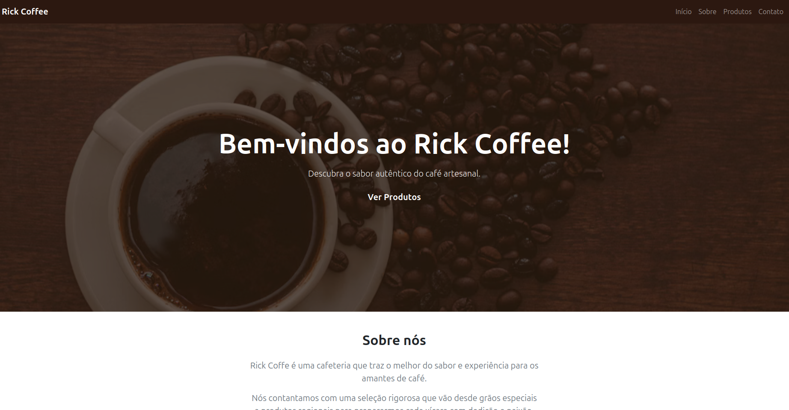

# ☕ Landing Page - Rick Coffee

Este é um projeto de uma landing page institucional desenvolvido para a cafeteria **Rick Coffee**. O objetivo principal foi praticar a criação de interfaces modernas, atrativas e responsivas, consolidando estudos em desenvolvimento web frontend.

O design original e a estrutura desta landing page foram baseados no conteúdo educacional desenvolvido por **Rodolfo**, do canal **DevClub** no YouTube.

## 📝 Sobre o Projeto

A **Rick Coffee** é uma cafeteria focada em trazer o melhor do sabor e experiência para os amantes de cafés artesanais, utilizando grãos especiais de produtores regionais. 

O projeto consiste em uma interface imersiva em tom escuro (*dark mode* com tons terrosos), focando na boa apresentação visual, hierarquia de informações e navegação fluida. A página apresenta a marca, destaca o cardápio de cafés e fornece informações de contato e localização.

## 🛠 Tecnologias Utilizadas

- **HTML5:** Estrutura semântica da página (cabeçalho, seções de conteúdo, menus e rodapé).
- **CSS3:** Customização visual avançada, trabalho com opacidade em imagens de fundo e tipografia.
- **Bootstrap 5:** Framework utilizado na atualização do projeto para garantir responsividade nativa, estilização ágil de componentes e alinhamento otimizado.

## 🚀 O que foi praticado

- **Criação de Hero Section:** Tela inicial com imagem de fundo, sobreposição de texto e botão de chamada para ação (Call-To-Action).
- **Componentes do Bootstrap:** Implementação de classes utilitárias para layouts rápidos e adaptáveis.
- **Design Responsivo:** Garantia de que a interface se adapte corretamente a dispositivos móveis, tablets e computadores.
- **Estruturação de Cardápio:** Exibição organizada de produtos, descrições e preços.
- **Versionamento:** Organização de arquivos e controle de versão com Git e GitHub.

## 📦 Detalhes do Cardápio Apresentado

- **Espresso:** Café puro e intenso, preparado na pressão certa.
- **Cappuccino:** Cremoso e suave, com espuma de leite perfeita.
- **Café Gelado:** Refrescante e saboroso para dias quentes.

## 🔗 Veja o projeto na prática

Você pode acessar a landing page rodando diretamente no seu navegador através do link abaixo:
👉 [Acesse a Rick Coffee aqui](https://ricardo-viniicius.github.io/landing-page-cafeteria/)

---
💡 *Projeto desenvolvido para fins de aprendizado e portfólio, com base nas aulas do DevClub.*
